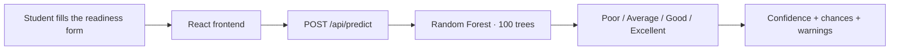

<div align="center">

# PrePilot

### Know if you are interview-ready — before the interview.

**PrePilot** tells a student how ready they are for an interview — **Poor, Average, Good or Excellent** — using their marks, coding practice and preparation. So students can see where they stand before the real interview.


[Quick start](#-quick-start) · [How it works](#-how-it-works) · [Model card](#-model-card) · [API](#-api) · [The SRS vision](#-the-srs-vision--interviewiq-ai-v10) · [Roadmap](#-roadmap) · [Known limits](#-known-limits)

</div>

---

## At a glance

| | |
|---|---|
| **What it is** | An interview-readiness checker with a React frontend and a Python ML API |
| **The model** | Random Forest · 100 trees · 37 features · trained on 60,000 records |
| **Test accuracy** | **92.89%** (Macro F1 **90.38**, simple baseline 47.11%) |
| **Target roles** | AI/ML Engineer · Data Engineer / Analyst · Full Stack Web Developer · SDE · Technical Support / QA |
| **Frontend** | React 19 + Vite · `react-router-dom` routes: `/`, `/login`, `/register` |
| **Backend** | Python HTTP API on port 5000 — plain Python only, no database yet |
| **Made by** | Khushboo Kaushik · B.Tech CSE (AIML), GLA University, Greater Noida |

---

## ✨ Quick start

You need **two things running**: the ML API and the frontend.

### 1. ML API — port 5000

```bash
pip install -r requirements.txt
python ml/server.py
```

### 2. Frontend — Vite dev server

```bash
npm install
npm run dev
```

Open the link Vite shows (by default http://localhost:5173). The form talks to the ML API at `http://127.0.0.1:5000` by default. To use a different address, copy `.env.example` to `.env` and set `VITE_API_BASE_URL`.

### Other commands

```bash
npm run build    # production build
npm run preview  # serve the production build
npm run lint     # ESLint
```

---

## 🔮 How it works



1. The student fills the form — CGPA, DSA score, mock-test scores, target role and more.
2. The form sends it to `POST /api/predict`.
3. The model gives back the readiness class, a confidence score, the chance for each class, and how long the prediction took — plus a warning for every field it had to fill in from training medians, so nothing is guessed in secret.

---

## 🧠 Model card

These numbers come from `ml/model_metadata.json` — they are measured, not made up.

| | |
|---|---|
| Model | RandomForestClassifier — 100 trees, `random_state` 42, balanced split |
| Features | **37** (33 numbers, 4 categories) |
| Training data | **60,000 records** — 48,000 for training / 12,000 for testing |
| Test accuracy | **92.89%** |
| Macro F1 | **90.38** |
| Weighted F1 | 92.91 |
| Simple baseline (DummyClassifier) accuracy | 47.11% |
| Degrees it supports | B.Tech only |
| Target roles it supports | AI/ML Engineer · Data Engineer / Analyst · Full Stack Web Developer · Software Development Engineer (SDE) · Technical Support / QA Engineer |

> **Note:** the training dataset file (CSV) is not kept in this repo, so you can run and use the model, but you cannot train it again from a fresh copy of this repo.

---

## 🏗️ How the code is set up — what is actually built

```
preppilot-frontend/
├── src/                      React frontend (Vite)
│   ├── pages/                Home, Login, Register (react-router-dom routes)
│   ├── components/           Navbar, Hero, Features, PredictorForm, Footer
│   └── lib/                  Browser-only helpers (see "Accounts" below)
├── ml/                       Python ML side
│   ├── server.py             HTTP API on port 5000 (plain Python only)
│   ├── predict.py            Prediction steps (checking inputs, filling gaps, predicting)
│   ├── train_readiness.py    Script to train the model
│   ├── export_model.py       Saves the .joblib model + metadata
│   ├── model_metadata.json   Feature list, medians and test scores
│   └── preppilot_readiness_model.joblib   Trained model
├── requirements.txt          Python packages needed
└── README.md                 You are here
```

---

## 🔌 API

| Method | Link | What it does |
|---|---|---|
| `GET` | `/api/health` | Tells if the service is up, the model name and the roles it supports |
| `GET` | `/api/roles` | Lists the target roles it supports |
| `POST` | `/api/predict` | Gives a readiness prediction for a profile |

`POST /api/predict` takes a JSON object with any of the 37 model features (full list in `ml/model_metadata.json`).

```bash
curl -X POST http://127.0.0.1:5000/api/predict \
  -H "Content-Type: application/json" \
  -d '{"cgpa": 8.4, "dsa_score": 82, "target_role_match": "Software Development Engineer (SDE)"}'
```

<details>
<summary><strong>Example answer</strong></summary>

```json
{
  "status": "success",
  "predicted_class": "Good",
  "confidence": 0.81,
  "probabilities": { "Average": 0.09, "Excellent": 0.08, "Good": 0.81, "Poor": 0.02 },
  "target_role": "Software Development Engineer (SDE)",
  "prediction_time_ms": 12.4,
  "warnings": ["Missing numeric feature 'age'; defaulted to benchmark median 20.0."],
  "mode": "live_ml"
}
```

</details>

If some fields are missing, the prediction steps fill them with the training medians, and every such fill is sent back in the answer as a warning.

---

## 📘 The SRS vision — InterviewIQ AI v1.0

This project started with a written plan: **InterviewIQ AI — Intelligent Interview Preparation and Personalized Career Coaching Platform**, Software Requirement Specification v1.0, September 2026 (GLA University). Everything in this part comes from that SRS. It is the big picture this product is growing towards — and it is kept apart from what is built today, because the two are not the same yet.

### What the SRS plans to build

A website where students **upload resumes, take AI mock interviews, and get smart feedback** on how they did — with skill-gap checks and learning tips made for them. It clearly says it will **not** give live human coaching or direct job placement. It only helps with the preparation part, through auto checks and tips.

**Who uses it:** Candidate — a logged-in student who uploads resumes, takes mock interviews, sees their progress, and gets tips.

### What the SRS asks for — and where each point stands

| ID | What the SRS asks for | Where it stands in this repo |
|---|---|---|
| FR-1.1 | Sign up and log in with **JWT-based login** | 🗓️ Planned — Login/Register pages are there, but login works only in the browser today (see [Accounts](#-accounts--honest-status)) |
| FR-1.2 | Upload a **PDF resume** | 🗓️ Planned |
| FR-1.3 | Pull out skills from the resume using **spaCy** | 🗓️ Planned |
| FR-1.4 | Say no to resume files bigger than **5 MB** with a "File size exceeded" error | 🗓️ Planned |
| FR-2.1 | Take a text-based interview answer; say no to empty answers with an "Answer required" error | 🗓️ Planned |
| FR-2.2 | Give a **similarity score (0–100)** for every answer, using Sentence-Transformers | 🗓️ Planned |
| FR-2.3 | Show a **Skill-Gap Report** after a session of at least 5 questions | 🗓️ Planned |
| FR-2.4 | When the NLP service is down, give a keyword-based score marked **"Basic Evaluation"** | 🗓️ Planned |
| FR-2.5 | Show progress across the **last 5 interview tries** | 🗓️ Planned |

### Other must-haves (non-functional)

| ID | What the SRS asks for | Where it stands |
|---|---|---|
| NFR-1 | A similarity score in **under 3 seconds** | 🗓️ Planned — the current predictor answers in milliseconds (one test took 12.4 ms) |
| NFR-2 | Passwords saved with **bcrypt** | 🗓️ Planned — no passwords are saved today |
| NFR-3 | Every interview try is saved, linked to one **UserID** | 🗓️ Planned |
| NFR-4 | Database up **99% of the time**, so no history is lost | 🗓️ Planned — there is no database yet |

### How the SRS plans the system

| Part | What it does (SRS) |
|---|---|
| Frontend (React) | Profile pages and the interview chat window |
| Backend (Node.js) | Login, sessions, and history saved in **PostgreSQL** |
| NLP Services (FastAPI) | Resume work and answer checks using **Sentence-Transformers** |
| Recommendation Engine | Suggests learning material based on weak skills |

**Big choices from the SRS**

| # | Choice | What was said no to | Why |
|---|---|---|---|
| D1 | **PostgreSQL** | MongoDB | Tables suit mapping scores to skills and users for progress checks |
| D2 | **Sentence-Transformers** | Keyword matching | Keyword matching fails when a user uses other words for the same thing (e.g. "fast" vs "efficient") |
| D3 | **FastAPI (Python)** for ML | Node.js for ML | Python has better ready-made tools for NLP models like spaCy and SBERT |

**What the SRS needs to run:** HuggingFace Sentence-Transformers for word meaning · Vercel to host the frontend · FastAPI on a GPU machine for NLP work.

**Limits the SRS sets:** C1 — checks are only for written technical and HR answers. C2 — the readiness data only comes from past tries inside the platform.

### The dataset the SRS talks about

| Point | What the SRS says |
|---|---|
| Dataset name | Preppilot Company Interview Preparation & Student Performance Dataset |
| Where it comes from | Company-given / public interview prep test kits and job needs, collected and cleaned by the Preppilot team; plus public company job pages and interview prep material (links to be added for each source in the dataset notes) |
| Rules for use | Rules to be written for each source. Only public data that can be reused; company-private test questions will not be shared again; questions made by the team will be marked as team-made |
| Size | Target **20,000–30,000 records** (final count after collecting, cleaning and removing duplicate rows) |
| What it predicts | Company Readiness Score / Readiness Class — **Ready / Almost Ready / Not Ready** for one company's hiring process |
| Type of task | Multi-class prediction, with a readiness score (%) as an extra output |
| Main score to judge by | **Macro F1** — Ready, Almost Ready and Not Ready count the same, because calling a weak student "ready" gives wrong tips |
| Simple baseline | Most-common-class baseline (score to be worked out from the final data) |
| Known data problems | Same questions twice, mixed difficulty tags, missing answers/options, different question styles across companies, uneven question counts per company/topic, team-made vs real questions, missing company needs — all to be fixed while cleaning the data |

> **One honest twist.** The SRS says the Random Forest readiness predictor is *not part of the first version on purpose* — it needed lots of user data that would not be there in the first sprint. In real life the order changed: the predictor, trained on 60,000 records, became the working heart first, and the NLP, login and resume work is the next step. This README shows both stories side by side instead of mixing them into one.

### How to know it is done (SRS checks)

- **AC-1** — Log in with the right details → you reach the Interview Dashboard.
- **AC-2** — Upload a resume → the "Skills" part of your profile fills up correctly.
- **AC-3** — Give a right answer in your own words (not the same words as the sample answer) → you still get a high score (above 0.8).
- **AC-4** — Try to take an interview without logging in → you are sent back to the login page.

### Not part of this release (SRS)

- Video interview checks (face and body language in real time)
- Payment / paid plans for premium coaching
- Live recruiter portal (talking to real recruiters directly)

### Project dates (SRS plan)

| Step | What is ready | Date |
|---|---|---|
| Sprint I | First working model (prototype) | 27 Sep 2026 |
| Sprint II | App 50% ready | 17 Oct 2026 |
| Sprint III | App 75–80% ready | 7 Nov 2026 |
| **Testing & Checks** | Test report and bug list | **17 Nov 2026** |
| **Launch & Docs** | Live app, user guide, tech docs | **30 Nov 2026** |
| Final Presentation | Final report, slides and viva | 5–10 Dec 2026 |

---

## 🗺️ Roadmap

Taken from the SRS first version and the plan above — in the right order:

1. ✅ **Readiness predictor, end to end** — the working heart (this repo, today)
2. 🗓️ **Real accounts** — JWT login + bcrypt (FR-1.1, NFR-2), in place of the browser-only login
3. 🗓️ **Resume upload + spaCy skill pull-out** (FR-1.2, FR-1.3, FR-1.4)
4. 🗓️ **NLP mock interviews** — similarity scores (FR-2.1, FR-2.2), with the "Basic Evaluation" fallback (FR-2.4)
5. 🗓️ **Skill-gap reports and tips** (FR-2.3) and progress views for the last 5 tries (FR-2.5)
6. 🗓️ **Saving data** — Node.js + PostgreSQL backend (D1), history and progress checks (NFR-3, NFR-4)
7. 🗓️ **Launch** — Vercel frontend, FastAPI NLP service (as per the SRS plan, by 30 Nov 2026)

---

## 👤 Accounts — honest status

PrePilot has **no account server yet**. The Login and Register pages only check the form in the browser and keep the login in `localStorage` on the user's own device. No account is made on a server, no password is saved or sent anywhere, and no page says otherwise. When a real login backend is built (FR-1.1), `src/lib/localUser.js` is the one file to change.

---

## ⚠️ Known limits

- The model cannot be trained again from this repo (dataset not kept here).
- `ml/server.py` shows `records_evaluated: 60000` in its `model_info` part, but the real test used the 12,000-record test set from `ml/model_metadata.json`.
- The frontend has no auto tests yet; checks done so far are lint + production build + by-hand / API quick live tests.
- The SRS classes (Ready / Almost Ready / Not Ready) and the model classes (Poor / Average / Good / Excellent) use different names — they will need one shared mapping when the two parts join.

---

## 📄 About the project

**Made by:** Khushboo Kaushik — B.Tech Computer Science & Engineering (AIML), GLA University, Greater Noida · Roll No. 22515500046 · Section NE

**Plan:** InterviewIQ AI — Software Requirement Specification, Version 1.0, September 2026.

All are welcome to help — please keep changes small and focused, check the build (`npm run build`) and the ML endpoints before opening a pull request, and do not add secrets, datasets or login details to the repo.
